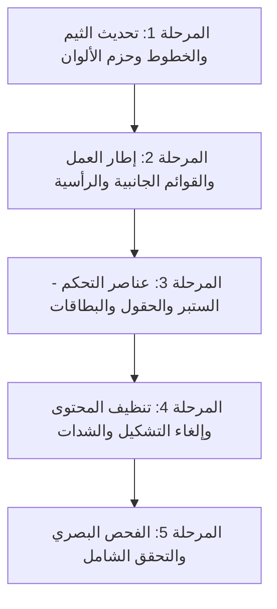

# خطة التنفيذ الشاملة للتحول البصري (Visual Redesign Execution Plan)
## تبني الروح الجمالية الأكاديمية الدافئة (Warm Academic Editorial Aesthetic)

---

### 1. الرؤية والمبادئ الأساسية (Vision & Core Principles)

الهدف من هذه العملية هو إضفاء **"الروح الجمالية" (Aesthetic Spirit)** الخاصة بنموذج `institute-management-dashboard-redesign` على لوحة التحكم الحالية `admin-dashboard`، وتحويلها من النمط السيان/البارد إلى نمط أكاديمي دافئ وراقٍ مستوحى من هوية المعاهد التعليمية المرموقة، مع الالتزام الصارم بالضوابط التالية:

1. **الحفاظ التام على السلوك الوظيفي (Zero Behavioral Changes):**
   - عدم تعديل أي منطق برمجي (Controllers, Stores, Zustand slices, React Query Hooks, API Services, Validation Schemas).
   - الحفاظ على كامل دورة حياة المكونات ومصفوفة الصلاحيات وإدارة النماذج (Forms).
   - الحفاظ التام على بنية ومفهوم **الستبر المركب (Compound Stepper Pattern)** وطريقة تقسيمه العمودي (`Stepper.Sidebar` على اليمين و `Row Items` المتتالية على اليسار).

2. **التعديل البصري الصرف (Pure Visual & Design System):**
   - ينحصر التغيير في: لوحة الألوان (Palettes)، نوع وحجم الخطوط (Typography)، أبعاد الحشو والهوامش (Padding & Margin)، انحناءات الحواف (Border Radius)، الحدود (Borders)، الظلال المتناغمة (Warm Tinted Shadows)، وخلفيات البطاقات والصفحات.

3. **إلغاء التشكيل والشدات بالكامل (Complete Diacritics & Shaddat Removal):**
   - تنظيف وتجريد كافة النصوص والعبارات من التشكيل (الفتحة، الضمة، الكسرة، التنوين، السكون) والشدات (ّ) في جميع ملفات الواجهات والبيانات الثابتة لضمان مظهر عصري وسلس وسهل القراءة على الشاشات.

4. **تغيير نوع الخط (Modern Font Upgrade):**
   - استبدال خط `IBM Plex Sans Arabic` الحالي (الذي يبدو جافاً وميكانيكياً) بخط عربي حديث وأنيق ودافئ مخصص لواجهات المستخدم الحديثة، وهو خط **`Readex Pro`** (مع توفير **`Tajawal`** كبديل مدعوم)، مع خط سيريف كلاسيكي للأرقام والعناوين اللاتينية `Playfair Display / Serif`.

---

### 2. جدول مطابقة الرموز البصرية (Design Tokens Translation Matrix)

| العنصر البصري | التصميم الحالي (Old Cold Slate/Cyan) | التصميم الجديد (Warm Academic Editorial) | الكود اللوني / القيمة |
| :--- | :--- | :--- | :--- |
| **خلفية الصفحة (Canvas Bg)** | رمادي بارد فاتح `#f8fafc` | بيج كريمي دافئ (Parchment Cream) | `#f5eee6` |
| **خلفية البطاقات (Card Surface)** | أبيض صافٍ `#ffffff` | بورسلين عاجي دافئ (Warm Porcelain) | `#fffaf5` و `#fbf7f2` |
| **اللون الأساسي (Primary)** | سيان فيروزي `#008fae` | عنابي برغندي فخم (Institutional Wine) | `#491d2b` |
| **اللون الثانوي (Accent/Gold)** | تيل نعناعي `#0d9488` | مغرة ذهبية / جملي دافئ (Golden Ochre) | `#c4a66b` / `#8b6a34` |
| **الحدود (Borders)** | رمادي بارد `#e2e8f0` | بيج رملي دافئ وناعم (Warm Sand Border) | `#e5d9cf` / `#e4d7cb` |
| **نص العناوين والنصوص الرئيسية** | كحلي داكن `#0f172a` | كحلي فحمي دافئ مائل للبرغندي | `#351b25` |
| **النصوص الثانوية والمكتومة** | رمادي صخري `#64748b` | رمادي دافئ مائل للترابي (Warm Taupe) | `#806c69` / `#9d817a` |
| **اللون التحذيري/الحرج (Danger)** | أحمر حاد `#ef4444` | قرمزي دافئ (Muted Crimson Wine) | `#9b4b51` |
| **نوع الخط الرئيسي (Body Font)** | `IBM Plex Sans Arabic` | **`Readex Pro`** (أو `Tajawal`) | `Readex Pro, sans-serif` |
| **انحناء الحواف (Border Radius)** | صغير ومستطيل (8px - 10px) | انسيابي ناعم وفخم (12px - 16px) | `12px` للعناصر، `16px` للبطاقات |
| **الظلال (Shadows)** | ظلال سوداء باهتة `rgba(0,0,0,0.05)` | ظلال ملونة دافئة | `0 6px 18px rgba(73, 29, 43, 0.06)` |

---

### 3. تدريجات الألوان المعتمدة في الثيم (Mantine Color Tuples)

سيتم تحديث ملف `src/theme/colors.ts` لتوليد تدرج Mantine المكون من 10 درجات متوازنة بصرياً:

#### أ. تدريج اللون الأساسي (Primary - Institutional Wine `#491d2b`):
```typescript
export const academicWineColor: MantineColorsTuple = [
  '#fbf5f5', // 0: خلفية ناعمة جداً للعناصر المفعلة
  '#f3e6e7', // 1: خلفية الأوسمة (Badges) الخفيفة
  '#e6c8cc', // 2: حدود تركيز ناعمة
  '#d6a5ab', // 3: تدرج متوسط
  '#b36e78', // 4: أيقونات ثانوية
  '#803c48', // 5: أزرار ثانوية وتدرج نشط
  '#491d2b', // 6: اللون الرئيسي المعتمد (Primary Brand)
  '#3d1824', // 7: حالة التمرير (Hover)
  '#30131d', // 8: تدرج داكن عميق
  '#200b13', // 9: أقصى درجات العمق
];
```

#### ب. تدريج اللون الذهبي الثانوي (Accent - Golden Ochre `#c4a66b`):
```typescript
export const goldenOchreColor: MantineColorsTuple = [
  '#fcf9f2', // 0: خلفية دافئة جداً
  '#f7f0df', // 1: خلفية أوسمة ذهبية
  '#eeddbb', // 2: حدود ذهبية فاتحة
  '#e4c791', // 3: إضاءات ناعمة
  '#d7b36a', // 4: عناصر إرشادية
  '#c4a66b', // 5: اللون الذهبي البارز (Accent)
  '#a27d3b', // 6: درجات الحالات والتأكيدات
  '#8b6a34', // 7: نصوص ذهبية داكنة مقروءة بوضوح
  '#6e5329', // 8: نصوص داكنة جداً
  '#4d391c', // 9: هوامش متقدمة
];
```

#### ج. تدريج الأسطح الدافئة (Warm Slate / Sand Surfaces):
```typescript
export const warmSandNeutral: MantineColorsTuple = [
  '#f5eee6', // 0: خلفية لوحة التحكم العامة (Canvas)
  '#fbf7f2', // 1: خلفية القائمة الجانبية والرأسية
  '#fffaf5', // 2: خلفية البطاقات الأساسية (Cards)
  '#f0e3d8', // 3: خلفيات الحاويات الثانوية
  '#e5d9cf', // 4: الحدود الأساسية (Borders)
  '#b29a8e', // 5: الأيقونات والعناصر المكتومة
  '#9d817a', // 6: النصوص الإرشادية والتاريخ
  '#806c69', // 7: النصوص الثانوية المكتومة
  '#4a373b', // 8: النصوص الداكنة
  '#351b25', // 9: نصوص العناوين الرئيسية (Headings)
];
```

---

### 4. الترقية الطباعية وحذف التشكيل والشدات (Typography & Diacritics Clean-up)

#### أ. الخط الجديد (`Readex Pro`):
- سيتم تحميل خط `Readex Pro` بأوزانه (`300`, `400`, `500`, `600`, `700`) من `next/font/google` في ملف `src/app/layout.tsx`.
- يمتاز هذا الخط بهندسة عربية حديثة مع منحنيات انسيابية راقية تريح العين، مع تناغم فائق مع الأرقام والرموز اللاتينية.
- تخصيص أوزان النصوص:
  - العناوين الرئيسية `h1`, `h2`: وزن `600` أو `700` ولون كحلي برغندي `#351b25`.
  - نصوص التسميات (Labels) والأزرار: وزن `500` ولون `#351b25` أو `#806c69`.
  - الأرقام والإحصائيات: خط عريض وواضح بأناقة رقمية سلسة.

#### ب. استراتيجية إلغاء التشكيل والشدات:
سيتم تطبيق تجريد شامل للنصوص باستخدام تعبير قياسي آمن يزيل كافة المحارف في النطاق:
`[\u064B-\u0652\u0653-\u065F]`
- **التنوين:** (ً ٍ ٌ) -> تحويل مثل: `مسبقاً` إلى `مسبقا`، `حالياً` إلى `حاليا`، `آلياً` إلى `اليا` أو `تلقائيا`.
- **الحركات القصيرة:** (الفتحة َ، الضمة ُ، الكسرة ِ، السكون ْ) -> تحويل مثل: `الشُعب` إلى `الشعب`، `يُحدد` إلى `يحدد`، `تُستخدم` إلى `تستخدم`.
- **الشدات:** (ّ) -> تحويل مثل: `المكلّف` إلى `المكلف`، `تثبيت` بدون شدة.

**الملفات المستهدفة بالتنظيف النصي:**
1. `src/components/controllers/sidebar/init/navigation.ts` (القوائم وتبويبات الشعب)
2. `src/app/(dashboard)/timetable/**` (كافة مودالات وشاشات الجدول المدرسي)
3. `src/app/(dashboard)/students/**` (معالج تسجيل الطلاب الجديد، كروت الخطوات، وحقول المراجعة)
4. `src/app/(dashboard)/teachers/**` (تفرغ المعلمين، المؤهلات، والحصص)
5. `src/app/(dashboard)/subjects/**` (المواد والمقررات والشعب المرتبطة)
6. `src/app/(dashboard)/sections/**` (الشعب والفصول والرسوم)
7. `src/app/(dashboard)/schedule-settings/**` (إعدادات الدوام، أيام العمل، وتوزيع الحصص)
8. `src/app/(dashboard)/institutes/**` و `src/app/login/**` (نصوص التنبيهات ورسائل تسجيل الدخول)

---

### 5. خطة تجميل المكونات وتطبيق "الروح" (Component-Level Refinement)

#### 1. الهيكل العام والإطار الخارجي (`LayoutController` & `Header`):
- **الخلفية العامة للشاشة (`body`):** لون الكريمي الدافئ `#f5eee6`.
- **الهيدر العلوي (`Header.tsx`):**
  - خلفية عاجية نصف شفافة بتأثير الزجاج المشوش (`backdrop-blur-md` مع لون `#f5eee6`/90).
  - خط سفلي ناعم بلون الرمل الدافئ `#e4d7cb`.
  - تحسين شكل مربع البحث ليكون بخلفية `#fffaf5` وحدود دافئة تكتسب إطاراً ذهبياً `#c4a66b` عند التركيز (`focus`).
  - تعديل شكل صورة/أيقونة المستخدم إلى دائرة برغندية فخمة `#491d2b` بنص عاجي ناعم `#f5eee6`.

#### 2. القائمة الجانبية (`DesktopSidebar.tsx` & `MobileSidebar.tsx`):
- **الخلفية:** بورسلين عاجي `#fbf7f2` مع حد فاصل يساري بلون `#e4d7cb`.
- **شعار المعهد (Institute Header):**
  - أيقونة المعهد بخلفية برغندية `#491d2b`، زوايا مستديرة (12px)، مع ظل برغندي دافئ `shadow-[0_6px_18px_rgba(73,29,43,0.18)]`.
  - اسم المعهد بلون الكحلي البرغندي `#351b25`.
- **عناصر القائمة (`NavLinks`):**
  - العنصر النشط (`active`): خلفية برغندية `#491d2b`، نص ناصع `#fff9f3`، مع نقطة تمييز ذهبية صغيرة `#c4a66b` على الطرف الأيسر وظل ناعم `0 8px 20px rgba(73, 29, 43, 0.15)`.
  - العناصر العادية: نص باللون الترابي الدافئ `#806c69`، وتأثير التمرير (`hover`) بخلفية رملية فاتحة `#f1e7de` ولون نص برغندي `#491d2b`.
- **بطاقة سياق السنة الدراسية أسفل القائمة:**
  - خلفية رملية ناعمة `#f0e3d8` مع شريط تقدم باللون الذهبي `#c4a66b`.

#### 3. الستبر المطور (`AppStepper`):
- الحفاظ التام على التصميم الذي بنيناه (الشريط الأيمن والصفوف المتتالية على اليسار).
- تلوين الشريط الأيمن (`Stepper.Sidebar`):
  - مؤشر الخطوات المكتملة: خلفية ذهبية أو برغندية مع أيقونة التحقق.
  - مؤشر الخطوة الحالية: إطار برغندي دافئ `#491d2b` مع توهج خفيف ناعم.
  - الخط الرابط بين الخطوات بلون `#e5d9cf`.
- بطاقات الخطوات اليسارية (`Row Items`):
  - البطاقة المغلقة: خلفية `#fbf7f2` ناعمة، حدود `#e5d9cf` رقيقة، نص ثانوي مرتب، مع سهم توسيع أنيق.
  - البطاقة المفتوحة: تفتح بسلاسة، خلفية `#fffaf5` نقية، بدون كروت داخلية مكررة، مع تباعد متناسق بين الحقول (20px).
- أزرار التحكم والعمليات (`Actions`):
  - الزر الرئيسي "التالي / حفظ": برغندي فخم `#491d2b` مع نص عاجي وظل خفيف `hover:bg-[#351b25]`.
  - الزر الثانوي "السابق / إلغاء": خلفية بيج فاتحة أو حدود رملية `#e5d9cf` بلون نص ترابي `#806c69`.

#### 4. حقول الإدخال والاختيار (`Input`, `Select`, `DatePicker`):
- خلفية الحقول: `#ffffff` أو `#fffaf5`.
- لون الحدود الافتراضية: `#e5d9cf`.
- لون التركيز (`focus`): إطار ذهبي `#c4a66b` مع حلقة خفيفة دافئة بدلاً من الأزرق التقليدي.
- زوايا مستديرة ناعمة بحجم `10px` أو `12px`.

#### 5. الجداول ووحدات البيانات (`DataModule` & `Tables`):
- رأس الجدول (Table Header): خلفية رملية مريحة `#f5eee6`، نصوص باللون الترابي `#806c69` بأحرف نظيفة بدون تشكيل.
- صفوف الجدول: خطوط فاصلة رقيقة `#e5d9cf`، وتأثير تمرير ناعم `#faf4ee`.
- الأوسمة (Badges): درجات دافئة (أخضر عشبي هادئ للنشط، أحمر قرمزي للغائب/المعطل، ذهبي للمعلق).

---

### 6. جدول مراحل التنفيذ التدريجية (Step-by-Step Implementation Plan)



#### المرحلة الأولى: البنية التحتية للثيم والألوان والخط (Phase 1)
1. **تحديث `src/app/layout.tsx`:**
   - استيراد وتهيئة خط `Readex_Pro` من `next/font/google`.
   - تطبيقه كمتغير CSS وحقنه في وسم `<body>`.
2. **تحديث `src/theme/colors.ts`:**
   - إضافة مصفوفات الألوان الثلاث (`academicWineColor`, `goldenOchreColor`, `warmSandNeutral`).
   - تعيين البرغندي كلون أساسي والذهبي كثانوي.
3. **تحديث `src/theme/typography.ts`:**
   - ضبط خط `Readex Pro` كخط رئيسي افتراضي، وموازنة أحجام العناوين وتباعد الأسطر.
4. **تحديث `src/theme/components.ts`:**
   - تحديث المظهر الافتراضي لمكونات Mantine (Button, Paper, Card, TextInput, Select, Modal, Drawer, Badge) لتطابق الانحناءات (12px-16px)، الحدود الدافئة والظلال الملونة.
5. **تحديث `src/theme/index.ts` و `globals.css`:**
   - إسناد الألوان والأبعاد الجديدة وضبط خلفية `body` لتكون `#f5eee6`.

#### المرحلة الثانية: غلاف لوحة التحكم والتنقل (Phase 2)
1. **القائمة الجانبية (`DesktopSidebar.tsx` و `MobileSidebar.tsx`):**
   - استبدال الألوان الصلبة السابقة بألوان الثيم العاجي `#fbf7f2` والحدود `#e4d7cb`.
   - تعديل ألوان وحالات الروابط النشطة (البرغندي `#491d2b` والنقطة الذهبية `#c4a66b`).
2. **شريط التنقل العلوي (`Header.tsx`):**
   - ضبط الشفافية وضبابية الخلفية `#f5eee6`/90.
   - تلوين حقل البحث، شارات الإشعارات، وقائمة المستخدم المنسدلة.

#### المرحلة الثالثة: مكونات الإدخال والستبر والبطاقات (Phase 3)
1. **تحديث الستبر المركب (`src/components/controllers/stepper/ui/*`):**
   - تعديل ألوان خلفية الشريط الأيمن، مؤشرات الدوائر والخطوط المتصلة.
   - ضبط بطاقات `Row Items` لتعتمد الانحناءات العصرية والظلال الخفيفة.
   - تلوين أزرار العمليات (التالي / السابق / الحفظ).
2. **تحديث حاويات المودال والـ Drawer:**
   - ضبط زوايا الانحناء إلى `16px`، مع حدود رملية وظلال فاخرة.

#### المرحلة الرابعة: التطهير النصي وإزالة التشكيل والشدات (Phase 4)
1. تطبيق التنظيف على ملفات القوائم الجانبية `navigation.ts`.
2. تنظيف نصوص معالج إضافة الطالب وكافة خطواته (`Step1Family.tsx`, `Step2BasicInfo.tsx`, `Step3CustomFields.tsx`, `Step4Review.tsx`).
3. تنظيف نصوص شاشات الجداول (`timetable/**`).
4. تنظيف نصوص شاشات الشعب والمعلمين والمواد وإعدادات الدوام.
5. التأكد التام من عدم المساس بأي مفتاح كود برمجى (Keys أو Enums أو Field Names).

#### المرحلة الخامسة: الاختبار والتحقق البصري (Phase 5)
1. التحقق من سلامة البناء (`npm run build` أو مراجعة أخطاء TypeScript).
2. فتح الواجهات في المتصفح والتحقق من تناسق الألوان وسلاسة الخط.
3. اختبار التنقل وتعبئة النماذج لضمان عدم تأثر أي سلوك وظيفي.

---

### 7. ضمانات الأمان البرمجي (Non-Regression Guarantees)
- ✅ لا مساس بملفات `store/**` أو حالة Zustand.
- ✅ لا مساس باستدعاءات الـ API أو متحكمات البيانات `core/api/**`.
- ✅ لا مساس بأسماء الحقول البرمجية في النماذج (Form Values & DTOs).
- ✅ لا مساس بمنطق الستبر المعتمد على الخطوات أو التحقق من صحة المدخلات (Zod/Form validation).
- ✅ الحفاظ على استقلالية المكونات وقابلية التخصيص وإمكانية إضافة الثيمات المتعددة (Multi-tenant White-labeling).
